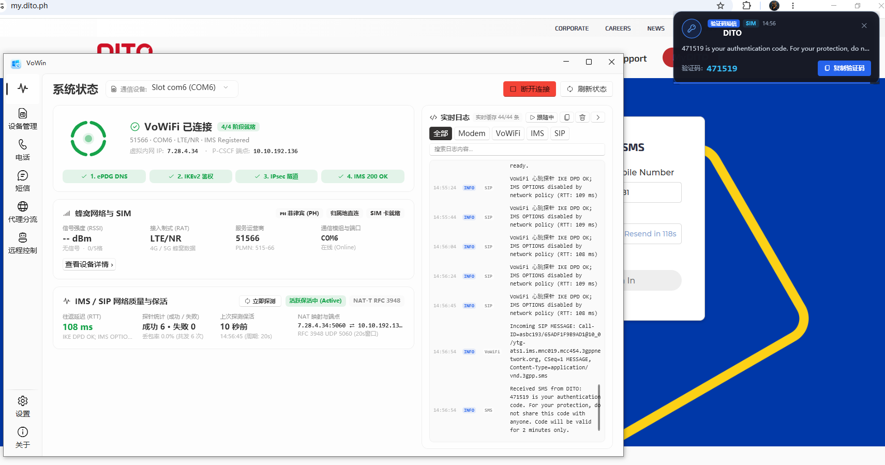

# VoWin：Windows 多线路通信网关

[English](README.md) | **简体中文**

[](https://github.com/unikgyd/VoWin/actions/workflows/release.yml)

<p align="center"></p>

VoWin 是面向 Windows 的 SIM／eSIM、模块语音、Host IMS、VoWiFi 与 SIP 网关桌面客户端。
Linux 端采用独立的 [VoCat-sip](https://github.com/unikgyd/VoCat-sip)（Go + React），
以成熟的 VoWin 行为为基准补齐能力，同时保留 Linux 已有的设备、网络、自动任务和通知功能。

## 双端进展

| 方向 | 当前工作区状态 |
| --- | --- |
| Windows | 继续使用 VoWin／VoSharp（C#）；本次 Linux 补齐不改 Windows 运行代码。 |
| Linux 基础通话 | 已接入网页电话、USB 模组 PCM、SIP 分机及可选 Asterisk peer、RFC 4733 按键。 |
| 多模组与恢复 | 已有逐模组控制、Host IMS、按卡 ePDG／重试记录、通话及媒体所有权隔离。 |
| 独立蜂窝／Wi-Fi 接入 | 正在接入按 ICCID 保存的两个连接开关、默认选路、换卡恢复及管理界面；本次新增源码尚未统一测试。 |
| 后续能力 | 保持／恢复、自动接听和留言播放、SIP INFO 兼容，以及完整实机生命周期与运营商验收仍待完成。 |

当前完整差异见 [VoCat 能力并集清单](https://github.com/unikgyd/VoCat-sip/blob/master/docs/FEATURE_UNION.md)。
历史阶段通过的测试只适用于对应源码快照，不能代替当前工作区或双端整体验收。
本次提交是开发进度保存，不是新发布包，也没有替换现用软件。

## 主要功能

- 多模组独立管理：SIM／eSIM 信息、短信、通话、蜂窝与 Wi-Fi 接入状态。
- 模块 USB 音频、Host IMS 和 VoWiFi 业务；具体可用能力取决于模组固件、SIM 与运营商。
- 本机电话、来电浮窗、短信会话、验证码查询及按需诊断。
- 可选 SIP 服务端、分机群振、手机短信桥接与 Asterisk peer。
- eSIM 配置文件管理、ePDG 发现与手动设置、代理分流、远程控制与通知。

各接入的注册成功不等于通话音频、短信送达或全部运营商兼容已经验收。

## 安装与上手

1. 使用 Windows 10／11 x64，并安装 **.NET 10 Desktop Runtime x64**。
2. 安装适合所用模组的厂商签名驱动，在设备管理器确认 AT／QMI／音频接口。
3. 从 [Releases](https://github.com/unikgyd/VoWin/releases) 获取发布包，运行 `VoWin.exe`。
4. 添加模组并确认 SIM 身份，然后按需配置蜂窝、Host IMS、VoWiFi、SIP 或远程提醒。

通信和音频能力依赖相应硬件接口；eSIM 管理需要 eUICC 与可用 APDU 通道。
发布包要求和安装说明以对应版本为准。

## 源码与仓库

| 路径／仓库 | 用途 |
| --- | --- |
| `VoWin/` | WPF 桌面界面、业务服务、设置和本地存储。 |
| `voSharp/` | SIM、模组、IKE、IMS、SIP、短信和通话协议实现。 |
| `qmi/` | QMI 通信及设备适配。 |
| [VoCat-sip](https://github.com/unikgyd/VoCat-sip) | 独立 Linux 仓库，默认分支为 `master`。 |

VoWin 的主分支为 `main`。本地 `VoCat-sip/` 和 `SimAdmin-sip/` 是独立仓库，不作为
VoWin 的隐式子模块提交；SimAdmin 保留作参考，Linux 当前主线为 VoCat-sip。
构建输出、测试结果、运行数据库、日志、本机凭据和设备诊断归档不纳入源码提交。

开发环境需要 .NET 10 SDK；发布脚本还需要 PowerShell 7。

```powershell
dotnet restore VoWin.slnx
dotnet build VoWin.slnx --no-restore
dotnet run --project VoWin/VoWin.csproj
```

本轮按先实现、后统一测试的顺序推进；README／Git 整理期间未执行测试或构建。

## 交流与许可

- [GitHub Issues](https://github.com/unikgyd/VoWin/issues)
- [Telegram 交流群](https://t.me/VoWindows1)
- [X / Twitter @Unikgyd99](https://x.com/Unikgyd99)

使用与再分发遵循本仓库 [LICENSE](LICENSE) 和各依赖的许可；VoCat-sip 另有自己的研究与评估许可，
不因双端整合而改变。项目用于合法授权的通信研究与测试，现有许可、地区准入和授权检查保持。

感谢 VoHive、VoCat 与 mdd-sim-gateway 的参考实现。

## 赞助支持

| 资产与网络 | 地址 |
| --- | --- |
| USDT · TRON（TRC-20） | `TDecoS5mFozuyfJSR2QhSsWbCkGm8nsvpH` |
| USDT · BNB Smart Chain（BEP-20） | `0x0e5e07b7604d8585fd936527f48874a10ad8b884` |
| USDT · Polygon | `0x0e5e07b7604d8585fd936527f48874a10ad8b884` |


